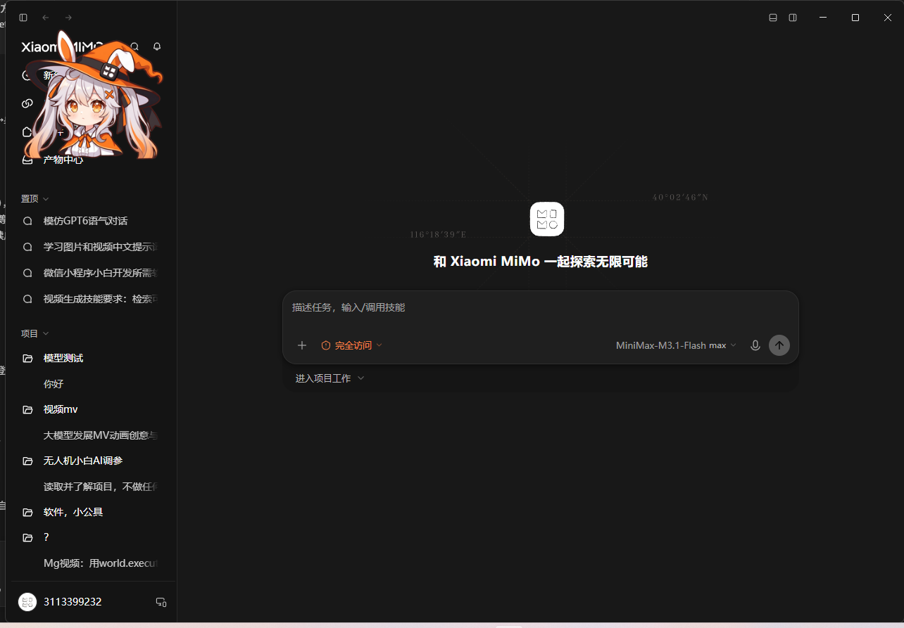

# MiMo 桌面宠物 🧙‍♀️

一只住在 **MiMo 桌面应用窗口内部** 的角色桌宠 —— 不是独立浮窗，而是 MiMo 主窗口的
**Win32 owned window**，跟着 MiMo 走、随 MiMo 最小化而隐藏。



## 它能做什么

| | |
|---|---|
| **联动唤醒** | MiMo 打开 → 桌宠自动出现；MiMo 关闭 → 桌宠自动退出（8 秒宽限等 MiMo 冷启动）|
| **跟随变脸** | MiMo 在忙 → `think`；出错 → `tired`；空闲 → `idle` |
| **额度气泡** | 单击桌宠 → 弹出小米额度 / 用量 / 当前状态 |
| **彩蛋贴纸** | 连点 30 次解锁，双击弹出 9 张表情包贴纸 |
| **自动贴边** | 贴着 MiMo 客户区边缘走，拖拽后记住你的位置 |
| **零打扰** | 静默常驻，**全程不弹任何终端窗口** |

---

## 快速开始（普通用户）

### 方式一：让 MiMo 帮你装（推荐）

在 MiMo 桌面端直接说：

> 帮我装一下 MiMo 桌面宠物

MiMo 的技能会带你看安装流程。

### 方式二：一条命令

```powershell
irm https://raw.githubusercontent.com/OWNER/mimo-desktop-pet/main/dist/install.ps1 | iex
```

（把 `OWNER` 换成仓库拥有者的用户名。）

### 方式三：手动

```powershell
git clone https://github.com/OWNER/mimo-desktop-pet.git
cd mimo-desktop-pet
pip install PySide6 pywin32 psutil websocket-client Pillow
python dist\skill\mimo-desktop-pet\scripts\install_pet.py --source .
```

装完 **打开 MiMo 桌面应用**，桌宠就会自己出现。

### 卸载

```powershell
python dist\skill\mimo-desktop-pet\scripts\uninstall_pet.py
```

停进程、删登录自启、删安装目录。

---

## 使用说明

### 交互

| 手势 | 行为 |
|---|---|
| 单击 | 弹额度气泡（贴纸亮着时 = 切回额度气泡查看用量）|
| 双击 | 弹表情包贴纸（贴纸已亮时 = 换下一张）|
| 三击 | 只换表情，4 秒后自动回到「跟随 MiMo」|
| 拖拽 | 挪到 MiMo 窗口任意位置，松手自动贴边 |
| 右键 | 菜单：临时换表情 / 重启 MiMo / 退出 |

### 气泡里能看到什么


- 当前 MiMo 状态（idle / thinking / error）
- 小米额度用量（需要你的 MiMo 账号有有效订阅）
- 本轮 token 消耗、剩余额度进度条

### 贴纸彩蛋

连点桌宠 30 次解锁，解锁后**双击**弹出 9 张表情包贴纸气泡。
进度存在 `pet\egg_state.json`，重启不会丢。

### 想自己改位置 / 大小

编辑 `%LOCALAPPDATA%\MiMoDesktopPet\pet\pet_config.json`：

| 键 | 含义 |
|---|---|
| `size` | 桌宠边长（像素，默认 220）|
| `snap` | 松手自动贴边 |
| `wander` | 空闲自动溜达 |
| `link_mimo` | 联动开关：MiMo 关 → 桌宠退 |
| `exit_grace` | 找不到 MiMo 多少秒后退出（默认 8）|
| `corner` / `x` / `y` | 位置（**客户区坐标**）|

> ⚠ **改配置前先停桌宠**：`python tools\pet_control.py stop` —— 不然退出时会把
> 内存里的旧配置写回去覆盖你的修改。

---

## 常见问题

| 现象 | 原因与处理 |
|---|---|
| 桌宠不出现 | 联动守护没跑。跑 `install_pet.py`，或手动 `pythonw.exe tools\launch_mimo_pet.py --watch` |
| MiMo 关了桌宠还在 | `link_mimo` 被关了，检查 `pet_config.json` |
| 气泡显示「无有效订阅」 | **不是 bug** —— 你的 MiMo 账号订阅过期，续订后自动恢复 |
| 气泡读不到额度 | MiMo 不是带调试端口启动的。桌宠右键菜单 →「重启 MiMo（启用额度读取）」 |
| 点了桌宠没反应 | 桌宠是透明窗口，只在角色实心处接收点击，别点窗口正中 |
| 双击不出贴纸 | 还没解锁，连点 30 次 |
| 安装后双击图标没反应 | 脚本在 `pythonw.exe` 下 `sys.stdout` 为 `None` 会秒死，所有脚本必须给 `reconfigure` 包 try/except（见 `references/使用与排错.md`）|

更多排错见 [`dist/skill/mimo-desktop-pet/references/使用与排错.md`](dist/skill/mimo-desktop-pet/references/使用与排错.md)。

---

## 依赖

| 包 | 用途 |
|---|---|
| Python 3.9+ | 运行时 |
| PySide6 | 桌宠窗口 / 气泡 / 托盘 |
| pywin32 | 找 MiMo 窗口、绑定 owner、读注册表 |
| psutil | 进程探测 |
| websocket-client | 连 MiMo 本地 API 事件流 |
| Pillow | 素材处理 |

```powershell
pip install PySide6 pywin32 psutil websocket-client Pillow
```

---

## 开发者

```text
pet/            桌宠本体（窗口 / 气泡 / 彩蛋 / 事件 / 额度）
tools/          启动器、控制 CLI、测试脚本
assets/         贴纸与源图
build/          精灵图（mimo-witch 256px / mimo-witch-mate 192px）
dist/skill/     ★ MiMo 桌面端技能包（SKILL.md + locales + scripts）
docs/           技术文档与交接文稿
```

- [`docs/MiMo-Mate-桌宠制作流程.md`](docs/MiMo-Mate-桌宠制作流程.md) — 完整技术文档
- [`docs/交接文稿.md`](docs/交接文稿.md) — 坑、验收方法、已知限制

跑测试：

```powershell
python tools\test_gesture.py       # 手势仲裁单测
python tools\test_egg.py           # 彩蛋逻辑单测
python pet\mimo_pet.py --selftest  # 渲染自检
```

**MI 欢迎提 issue 和 PR。**

---

## 许可

MIT。角色形象与贴纸为原创素材。

MiMo 是小米公司的产品，本项目是第三方桌宠，与小米无关。